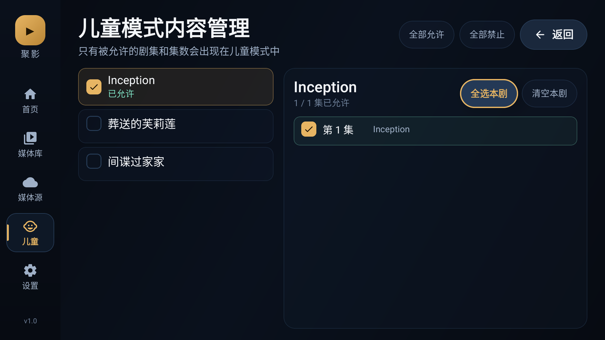
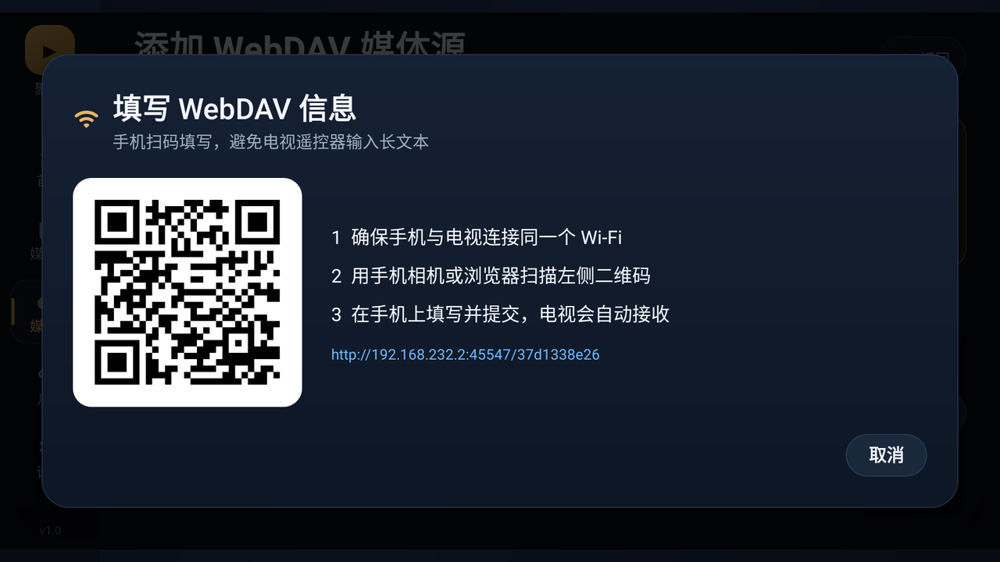

# 聚影 TV · Juying TV

一个为 Android TV 设计的本地 / 网盘媒体中心。把电视目录、U 盘、WebDAV、夸克网盘里的动画和影视统一扫描、自动归集，并以媒体库的方式重新组织、播放和做家长控制。


## 适配环境

| 项目 | 适配值 |
| --- | --- |
| 目标电视 | 小米电视 5 Pro 65"（MiTV-ANSP0 / jobs） |
| 系统 | Android 9（Pie，API 28） |
| 架构 | armeabi-v7a（32 位），APK 同时包含其他 ABI |
| 屏幕 | 面板 3840×2160，系统按 1920×1080 / 320dpi 渲染 |
| 应用 | `com.juying.tv`，minSdk 28，targetSdk 34 |
| 播放 | Media3 / ExoPlayer，使用电视硬件解码器 |

界面按 960×540dp 的电视安全区设计，已在 API 28、1920×1080、320dpi 的 Android TV 模拟器上逐项验证（首页、扫描、海报墙、媒体库、合集、播放、外挂字幕、续播、儿童模式、手机扫码填写），并用本地 WebDAV 服务联调了目录扫描、Range 流式播放与外挂字幕下载。夸克网盘需要你的真实账号 Cookie，未做账号侧联调。

## 安装

APK 已生成：

```
dist/JuyingTV-1.4.0.apk
```

### ADB 安装（推荐）

```bash
adb connect 192.168.1.196:5555
adb install -r dist/JuyingTV-1.4.0.apk
```

如果电视提示“禁止安装未知来源应用”，请在电视的开发者选项/安全设置中允许 ADB 安装。首次连接需要在电视上确认调试授权。

### U 盘安装

把 APK 复制到 U 盘，插入电视，用电视自带的文件管理器打开 APK 安装即可。

> 已在小米电视 5 Pro 真机（Android 9、armeabi-v7a、1920×1080/320dpi）完成安装与实机验证。

## 已实现功能

### 1. 媒体源

- **本机与 U 盘**：通过 MediaStore 自动扫描系统媒体库中的视频，无需逐个选择目录；扫描时会一并收录同目录的 `.srt / .ass / .ssa / .vtt` 字幕与 `poster/cover/folder` 封面图。
- **本地文件夹**：通过系统 SAF 目录选择器授权电视内置存储或外置 U 盘中的任意文件夹，权限会持久化。适合只收纳某个动画目录，避免扫到系统录像。
- **WebDAV**：Basic 认证，支持 NAS、AList/OpenList、群晖、坚果云等。支持递归扫描、目录根路径、外挂字幕下载与带鉴权播放。
- **夸克网盘**：Cookie 直连，支持目录递归扫描、视频/字幕识别、播放直链获取。添加/编辑源时可直接浏览网盘目录并多选扫描范围，只扫描选中的文件夹，避免“目录文件过多”；Cookie 只显示状态与字符数，不再撑高表单。夸克为非官方接口，详见下方说明。

支持格式：`mp4 / mkv / avi / ts / m2ts / m4v / mov / wmv / flv / webm / rmvb / mpg / mpeg / 3gp / vob / iso` 等（实际能否播放取决于电视硬件解码器）。


### 2. 自动归集为“剧集 / 电影”

扫描后不按原始路径展示，而是先做一层媒体归集：

- 识别 `S01E02`、`第 12 集`、`EP05`、`[05]` 等命名；
- 同一文件夹内的集数自动合并为一部剧；
- `Season 1 / S01 / 第一季` 等季目录会合并到同一部剧；
- 通用下载目录里同时放多部动画时，按解析出的剧名分别成组；
- 单文件且无集数标记的内容识别为电影；
- 文件名清洗会去除分辨率、编码、字幕组、语言等发布标签；
- 同目录的 `poster.jpg / folder.jpg / cover.jpg` 会自动作为剧集封面；
- 支持 `001.剧名...`、`【剧名】01. ...`、`01Numberblocks...`、`第10节` 等数字/方括号/课程命名，避免被截成 “001”；
- 同一命名文件夹中的数字前缀、共同剧名或“集/季/合集”标记会按剧集合并，避免每集都成为一部电影；
- 识别课程结构：同一课程的“版本分支”作为剧集，“第一级/第二级”作为季，剧集详情与播放器使用 S01E01 标签；
- 剧集列表直接展示每一集的缩略图（夸克取网盘缩略图并本地缓存，本地视频抽取画面帧），方便儿童按画面定位；缩略图加载失败时显示集数占位图；
- 实测一个包含 4863 个视频的夸克目录可归并为 123 部内容（119 部剧集 + 4 部电影），Wow English 的多个版本分支不再重复成 20 多部剧。

内置单元测试覆盖常见中/日/英动画命名与季目录、平铺目录、混合电影等场景：`./gradlew test`。


### 3. 媒体库管理

- **海报墙**：全部内容以海报网格展示；标题、年份、电影/剧集类型自动呈现。
- **自定义合集**：把不同来源的内容加入同一个合集，并自由调整顺序；合集可以设为“显示在首页”，成为独立的一行。
- **按原始目录添加**：合集添加内容时可直接浏览媒体源原始文件夹，选择目录即可批量加入其下内容，也可切回“按剧集”单独选择。
- **首页编排**：继续观看、最近加入、自定义合集行、全部内容；合集顺序可上移/下移。
- **编辑**：修改显示名称、封面 URL、隐藏内容、加入/移出合集、儿童模式允许状态。
- **搜索与筛选**：媒体库支持片名搜索，以及“全部 / 剧集 / 电影”筛选，适合大库；筛选无结果可直接清除条件。
- **隐藏与恢复**：隐藏只影响媒体库，不删除文件；管理页可以恢复。
- **续播**：自动记录每个视频的播放位置；“继续观看”基于真实进度，播放结束自动清除。
- **外挂字幕**：自动匹配同目录同名字幕；本地直接读取，WebDAV/夸克会带鉴权下载到缓存后加载。可手动切换字幕轨。


### 4. 播放器

- D-pad 遥控器交互：OK 显示/隐藏控制层、左右快退/快进 10 秒、返回键先收控制层再退出。
- 选集面板、上一集/下一集、自动连播（可关闭）、0.75–2.0 倍速。
- 画面比例：适应、裁切、拉伸、原始。
- 字幕轨选择、外挂字幕自动加载、字幕上移避开控制栏；自动检测 GBK/Big5 字幕并转成 UTF-8，避免乱码。
- 接入 Media3 FFmpeg 解码扩展：AC3 / EAC3 / DTS / DTS-HD / TrueHD / FLAC / ALAC 等特殊音轨可由软件解码兜底，H.264 / HEVC 也支持软件兜底。
- 开启解码器回退（硬件解码失败时尝试软件解码），并补充 HLS / DASH 流媒体解析。
- 优先选择中文音轨与中文字幕（多音轨 MKV 更友好）。
- 音频焦点与后台暂停：按 Home 离开应用会暂停并保存进度。
- 错误提示与重试；夸克链接过期时会提示重新进入播放刷新地址。


### 5. 儿童模式

- 家长锁：4–6 位数字 PIN，使用随机盐 + SHA-256 存储，不保存明文。
- 内容白名单：可以按剧集允许，也可以按集允许；支持“全选本剧 / 清空本剧 / 全部允许 / 全部禁止”。
- 儿童首页只显示被允许的剧集与电影；继续观看、最近加入、片库全部按白名单过滤。
- 儿童模式隐藏媒体源和设置入口，只保留首页 / 片库 / 家长 / 退出。
- 退出儿童模式、进入家长管理都需要 PIN。
- 儿童模式状态持久化，重启电视后仍然生效。
- 所有管理均可在遥控器上完成，不依赖触摸。




### 6. 手机扫码填写（无需在电视上打字）

添加 WebDAV / 夸克网盘时，电视会启动一个一次性局域网页面并显示二维码：

1. 手机与电视连接同一个 Wi-Fi；
2. 扫码打开页面，在手机上填写长地址、密码或 Cookie；
3. 提交后电视立即接收并回填表单，服务随即关闭。

页面只监听局域网，URL 含随机令牌，不上传任何数据到云端。此流程已在模拟器中通过真实 HTTP POST 验证。



## 刮削与自动整理（豆瓣 + TVmaze + TMDB）

设置页提供 **多源影视/动画刮削**：

- 中文片名优先用豆瓣联想搜索，英文动画/剧集优先 TMDB，TVmaze 作为补充；
- TMDB 走 `api.tmdb.org`（国内网络可直连，`api.themoviedb.org` 通常不可达），内置公开演示 Key，失效时自动回退豆瓣/TVmaze；
- TMDB 海报走 `image.tmdb.org` 背后的 `tmdb-image-prod.b-cdn.net` CDN（电视可直连），不依赖代理；
- 按清洗后的片名、年份、剧集/电影类型做评分匹配；课程、儿歌、字母拼读等无元数据的内容会自动跳过；
- 结果缓存 7 天（空结果 12 小时），重新刮削不会重复打接口；
- 豆瓣请求间隔 3.2–4.4 秒，遇到 403/429/验证页会自动暂停 60 秒；连续空结果会触发探活；如果豆瓣整体限流，本次批量会自动跳过豆瓣，使用 TMDB/TVmaze 与缓存；
- 剧集详情页新增「刮削」按钮，可单独刮削当前剧集并立即看到匹配结果；
- 支持“自动合并同作品重复条目”（按条目 ID 合并媒体、播放进度、合集引用）和“按年份自动建合集”；
- 未匹配的内容保留原始目录与当前命名；海报下载到本机缓存，避免防盗链。

刮削需要电视能访问 `movie.douban.com`、`api.tvmaze.com` 与 `api.tmdb.org`。设置页「测试刮削源」会分别检查三个源；豆瓣匿名接口在高峰期仍可能返回空数组，应用会暂停重试。内置 TMDB Key 来自公开教程，可能被撤销；可以在源码 `TmdbClient.kt` 中替换为自己的 Key（API 与海报域名已验证可从电视直连）；豆瓣接口不是公开 API，仅建议个人媒体库自用。

## AI 智能整理（阿里云百炼）

设置页提供 **AI 智能整理**：

- 支持 OpenAI 兼容供应商：阿里云百炼、OpenAI、DeepSeek、硅基流动、OpenRouter、Moonshot、智谱 GLM，以及 LiteLLM / New API / One API 等自建网关；每个供应商单独保存 Key；
- 模型列表优先从供应商 `/models` 读取最新模型，也可手机填写自定义模型名；
- 剧集详情页「AI 整理」：把文件名和所在目录交给模型，推断季/集、规范标题，并为缺失封面联网找图；执行中按钮转圈显示“整理中…”，头部横幅展示当前阶段，完成后显示“已完成”；
- 设置页可「AI 整理全部剧集」「AI 补齐缺失封面」，带费用提示、进度和取消；
- 长剧集按 40 集分块、流式接收模型输出，避免 100+ 集一次性 JSON 超时或截断；
- 剧集标题会优先恢复作品品牌名：例如把“引进版 1 2级 中英”整理为“Wow English 引进版 1-2级 中英”；模型无法判断时从原始目录/文件名提取品牌，仍无法确定则保留原标题；
- 模型必须返回 JSON；应用按文件序号对应原文件，返回集数过少或无法匹配时直接放弃，避免破坏媒体库；
- 标题只做文件名清洗，模型无法推断时回退到清洗后的文件名，不编造剧情名；多季内容如果被模型折叠成单季，会保留原始季/集，只应用标题；
- 百炼下联网找封面使用原生 `enable_search`，会继续抓取搜索结果页面的 `og:image`；其他供应商没有统一搜索协议时，用第一集真实缩略图兜底；
- Key 仅保存在电视本机；调用模型会产生费用；联网图片建议家长抽查。

百炼默认走 `dashscope.aliyuncs.com`（国内可直连）；OpenAI 等其他供应商需要电视网络能访问对应 API，或使用自建 LiteLLM/New API 网关。Key 按供应商保存在本机，不写入代码或日志。

## MCP Agent 接入

应用内置一个局域网 MCP 服务，外部 Agent（Qoder、Cursor、Claude 等）可以直接管理媒体库：

- 设置 → MCP Agent 接入 → 开启 MCP 服务；
- 协议：Streamable HTTP，`POST http://<电视IP>:8787/mcp`，请求头 `Authorization: Bearer <Token>`；
- Token 在本机生成，可在「MCP 连接信息」查看/重新生成；只允许 10/172.16/192.168 等局域网地址；
- 工具包括：媒体库统计/搜索/详情/单集，剧集改名/换封面/儿童允许/隐藏，视频季集标题修改，合集增删改，扫描、刮削、AI 整理/找封面（异步任务 + 状态查询/取消），AI 供应商与模型列表；
- 不提供删除原文件、删除媒体源、读取 Cookie/API Key 的工具；Token 不写日志；
- 如果客户端只支持 SSE，可用 `npx mcp-remote http://<电视IP>:8787/mcp --header "Authorization: Bearer <Token>"` 桥接。

## 夸克网盘说明

夸克网盘没有公开的开放平台接口，本项目使用网页版的 Cookie 接口（`drive-pc.quark.cn`）：

1. 在电脑浏览器登录 [pan.quark.cn](https://pan.quark.cn/)；
2. 按 F12 → Network（网络）→ 刷新页面 → 点击任意请求；
3. 复制请求头里的完整 `Cookie`；
4. 在添加夸克媒体源时用“手机填写”粘贴到电视；
5. 点击“扫描范围”浏览网盘并多选具体动画/影视目录后保存，再扫描。

注意事项：

- Cookie 等同账号密码，**仅保存在电视本机的 Room 数据库**中（未加密），请勿分享 APK 数据库或截图；
- 夸克接口随时可能变化，失效时重新填写 Cookie；
- 播放直链有时效（本项目缓存 3 分钟），失效会提示重试；
- 夸克会在每次接口响应中通过 `Set-Cookie` 续期登录令牌（`__puus`）。应用会自动合并最新令牌再请求播放地址，避免出现「Cookie 还在、播放却返回 HTTP 412」的情况；
- 如果重新登录令牌本身也已过期（接口返回 31001），需要重新从浏览器复制 Cookie；
- 会员权益、文件风控可能影响播放；
- 如果追求更稳定的长期使用，推荐把夸克挂载到 **AList / OpenList**，再用本项目 WebDAV 源接入。

## 第三方播放组件

- Media3 / ExoPlayer 1.3.1（Apache-2.0）；
- Jellyfin `media3-ffmpeg-decoder` 1.3.1+2（GPL-3.0，内含 FFmpeg 软解，用于特殊音轨/编码兜底）；
- juniversalchardet 2.5.2（MPL-1.1 / GPL-2.0 / LGPL-2.1 三选一，用于字幕编码检测）。

如果后续公开发布 APK，需要遵守上述组件的许可证（尤其是 GPL 组件的源码提供义务）；个人自用不受影响。

## 构建

环境：JDK 17、Android SDK Platform 34、Build-Tools 34.0.0。

```bash
# 指向本机 SDK
echo "sdk.dir=/path/to/android-sdk" > local.properties

./gradlew :app:assembleDebug
# 或使用已配置的 release 流程：
./gradlew :app:assembleRelease
```

签名密钥位于 `release/juying-release.jks`（未纳入版本库），密码记录在 `release/keystore-info.txt`。升级安装必须使用同一签名。

项目结构：

```
app/src/main/java/com/juying/tv/
  data/
    db/              Room 实体、DAO、数据库
    source/          本地 SAF / MediaStore / WebDAV / 夸克扫描
    repo/            媒体库仓库、播放地址解析
    prefs/           家长锁与偏好设置
  ui/
    components/      电视焦点组件、海报卡、PIN 键盘、手机填写弹窗
    screens/         首页、媒体库、合集、剧集、播放器、媒体源、儿童管理、设置
    theme/           暗色影院主题
  AppViewModel.kt    扫描、整理、儿童模式、合集排序等状态
  MainActivity.kt
docs/screenshots/    实机界面截图
```

## 已知限制

- **没有自动刮削**：未接入 TMDB 等元数据服务（避免强制 API Key），默认使用本地封面或渐变占位；可在剧集/合集编辑中填写封面 URL。后续可加 TMDB 可选 Key。
- **外挂字幕**目前按文件名/集数匹配同目录字幕；字幕组命名差异极大时可能需要在文件同目录手动改成与视频同名。
- **解码能力取决于电视**：ExoPlayer 使用系统硬件解码器；部分 10bit/HEVC/DTS 组合在 Amlogic 电视上可能无法播放，可更换片源或转码。
- **夸克接口为非官方**，稳定性不由本项目保证。
- **WebDAV 若使用 HTTP**，Basic 认证信息为明文传输，建议只在家庭局域网使用或使用 HTTPS。
- 本地文件夹依赖系统 DocumentsUI；极少数定制 TV 固件可能隐藏该选择器，此时可用“本机与 U 盘”或 WebDAV。
- 未实现投屏、DLNA 服务端、TMDB 自动追番、云同步、多用户档案。

## 隐私

- 所有媒体索引、播放记录、家长锁、Cookie 都保存在电视本机；
- 应用不含统计 SDK、广告 SDK，不上传任何使用数据；
- 手机填写页面仅在填写期间监听局域网，提交或关闭后立即停止。

---

版本：1.4.0 · 构建日期：2026-11-05
